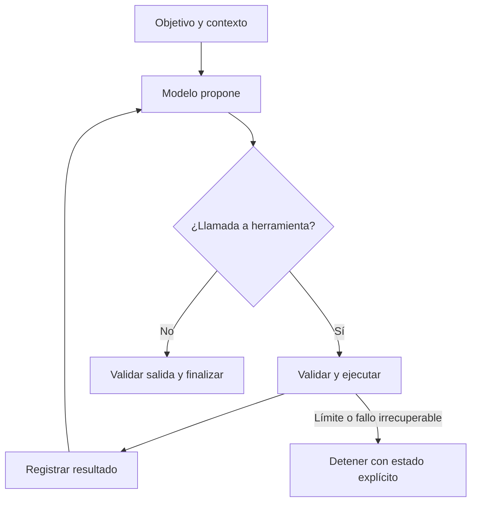

# 01 — Qué es un harness

Tiempo: 2 horas. Al finalizar distinguirás modelo, agente, harness y evaluador; diseñarás un contrato verificable.

## El problema que resuelve

Un modelo recibe contexto y propone una respuesta. Si le preguntas por un plazo que solo existe en un archivo, puede no conocerlo. Darle acceso a ese archivo exige software: decidir qué documentos exponer, ejecutar una lectura, devolver el resultado y conservar el historial. Ese software forma parte del **harness**.

Aquí usaremos el término para el entorno de ejecución de un agente: adapta el proveedor, ensambla contexto, ofrece herramientas, gestiona estado y decide cuándo continuar o parar. También se llama harness a un banco de evaluación. Son usos relacionados, pero distintos: el primero ejecuta tareas; el segundo ejecuta casos y mide resultados. En el módulo 10 conectarás ambos.

| Componente | Responsabilidad | Ejemplo de fallo |
| --- | --- | --- |
| Modelo | Proponer texto o llamadas | Inventa un dato |
| Herramienta | Ejecutar una operación | Acepta una ruta no permitida |
| Harness | Coordinar y controlar | Repite indefinidamente |
| Estado | Conservar información | Mezcla dos usuarios |
| Evaluador | Medir contra criterios | Premia una respuesta sin evidencia |

Un agente es el comportamiento del conjunto: percibe resultados, elige acciones y continúa hacia un objetivo. Cambiar el modelo puede mejorar propuestas; cambiar el harness puede corregir errores de validación, acceso o recuperación que un modelo mejor no resuelve.

## Harness, framework y producto

Un *framework* de agentes es una biblioteca para construir harnesses; un *producto* (un asistente de programación, un chat corporativo) es un harness ya configurado con interfaz. Pi es un harness extensible: puedes usarlo tal cual, extenderlo o integrarlo. En el curso construirás primero uno mínimo en Python para ver cada pieza y después extenderás Pi, donde muchas piezas ya existen y otras (límite de pasos, política de herramientas, evaluación) siguen siendo responsabilidad tuya.

## El bucle esencial

El modelo propone; el código decide qué ejecuta. No basta con escribir «no hagas operaciones peligrosas» en el prompt. Si una operación existe y tiene credenciales, el harness necesita controles ejecutables y, según el riesgo, límites del sistema operativo.

## Caso explicado

Pregunta: «¿Cuántos días de retención establece el proyecto?». El modelo solicita un documento, la herramienta devuelve la norma y el modelo responde citando su ID. La respuesta «30 días» puede ser correcta por casualidad; la traza debe demostrar qué fuente se consultó. El contrato exige dato, fuente y abstención si no hay evidencia.

Un contrato útil especifica entradas, salidas, acciones permitidas, límites y fallo. Para nuestro asistente: entrada textual de máximo acordado; salida JSON con `status`, `answer` y `sources`; herramienta documental de lectura; ninguna publicación; parada por plazo, error o respuesta final. Esto se puede probar.

## Ejemplo resuelto: contrato mínimo

| Elemento | Decisión | Cómo se comprueba |
| --- | --- | --- |
| Entrada | Pregunta en español, ≤ 500 caracteres | El host rechaza la entrada antes de llamar al modelo |
| Salida | Solo un objeto JSON `{status, answer, sources}` | `score.py` comprueba claves y tipos |
| Estados | `answered` con evidencia; `abstained` si falta el dato; `blocked` si piden publicar/borrar | Casos c05, c06, c10 y c11 |
| Acciones | Solo `lookup_document`, lectura por ID | Allowlist del runtime y política del evaluador |
| Límites | ≤ 6 llamadas, ≤ 8 turnos, ≤ 120 s por caso | Extensión `presupuesto.ts` y plazo del runner |
| Fallo | Error explícito; nunca «éxito vacío» | Tests del catálogo y del normalizador |

Observa que cada fila tiene una comprobación independiente del modelo. Si una fila solo se puede comprobar «preguntándole al modelo», todavía no es un contrato.

## Qué no debes construir todavía

No necesitas memoria vectorial, varios agentes ni una interfaz web para verificar el bucle. Primero consigue una llamada trazable y una respuesta verificable. Añade capacidades cuando una limitación observada las justifique. Más herramientas también crean más superficie de error y más contexto.

## Ejercicio de comprensión

Clasifica estos problemas: el dato no está en la fuente; el esquema acepta `"tres"`; el agente consulta diez veces lo mismo; un benchmark acepta cualquier texto con «30». Propón una corrección en el componente responsable.

## Errores frecuentes

- Confiar en el prompt como control: «no borres nada» no impide ejecutar una herramienta que borra.
- Evaluar solo la frase final: una respuesta correcta sin consulta es suerte, no evidencia.
- Definir el éxito como «el modelo parece seguro»: el contrato debe poder comprobarse con código o con revisión explícita.
- Añadir capacidades antes de medir: cada herramienta nueva amplía contexto, coste y superficie de ataque.

## Autoevaluación

1. ¿Qué componente es responsable de que un argumento `"tres"` no llegue a una función que espera un entero?
2. ¿Por qué «30 días» con `sources: ["d-001"]` no basta como evidencia de consulta?
3. Nombra dos límites que el harness debe imponer aunque el modelo sea excelente.
4. ¿Qué diferencia hay entre `abstained` y `blocked`?
5. ¿En qué se diferencia un harness de agente de un harness de evaluación?

Respuestas: [clave de autoevaluación](../soluciones/autoevaluacion.md#01).

Práctica: [laboratorio 01](../laboratorios/01-fundamentos.md). Continúa con [entorno Windows](02-entorno-windows.md).
