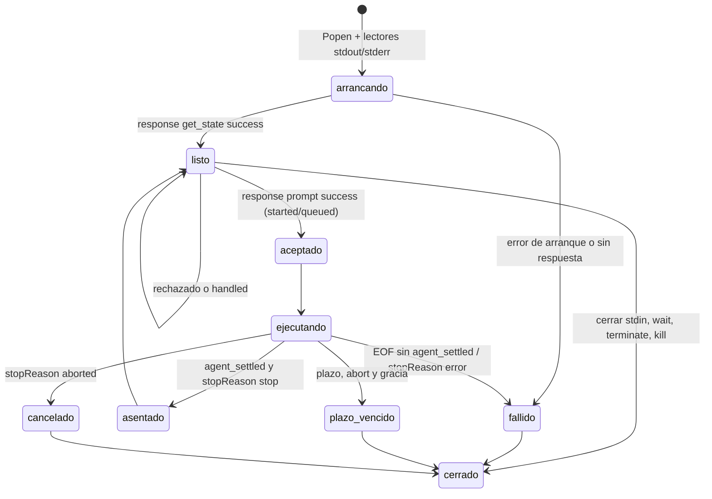

# 08 — Automatizar con SDK y RPC

Tiempo: 5 horas. Objetivo: elegir una frontera de integración, no confundir aceptación de un prompt con finalización y cerrar recursos incluso cuando algo falla.

## Elegir una interfaz

| Opción | Frontera | Ventaja | Trabajo adicional |
| --- | --- | --- | --- |
| Print | Proceso por tarea | Simple | Estado y verificación externos |
| JSON | Proceso por tarea | Traza completa | Consumir eventos y errores |
| SDK | Mismo proceso Node | Tipos y métodos directos | Gestión de recursos y dependencias |
| RPC | Proceso hijo persistente | Integrar Python u otros lenguajes | Protocolo, IDs y supervisión |

Un proceso hijo no constituye por sí solo un sandbox: hereda permisos si no se limita por el sistema operativo. Además, el canal RPC es **privilegiado**: acepta comandos como `bash` (ejecuta una orden directamente, sin pasar por el modelo), `set_model` o `compact`. Quien escribe en stdin controla Pi; no lo expongas a entradas no confiables.

## SDK mínimo del curso

Lee [run.ts](../ejemplos/sdk/run.ts) y su [README](../ejemplos/sdk/README.md). Crea una sesión en memoria sin herramientas (`noTools: "all"`), solicita un JSON sencillo y libera la sesión en `finally`. Usa `createAgentSession`, `session.prompt`, `getLastAssistantText` y `dispose`.

> Corrección de la edición 1.1: la 1.0 usaba `noTools: true`. En 0.99.1 el tipo es `"all" | "builtin"`, y `tsc` rechaza `true`. Lo detectó la comprobación de tipos: por eso el curso separa «ejecuta» de «compila».

La sesión sin herramientas sirve para comprobar autenticación, generación y contrato formal. No demuestra lectura de documentos. Sin credenciales, `prompt` lanza «No API key found»: es el comportamiento esperado.

## SDK documental

[run-documental.ts](../ejemplos/sdk/run-documental.ts) es el mismo asistente del curso integrado en proceso:

- `DefaultResourceLoader` con `noExtensions`, `noSkills`, `noPromptTemplates` y `noContextFiles`, más `additionalExtensionPaths` y `additionalPromptTemplatePaths` explícitos;
- `tools: ["lookup_document"]` como allowlist;
- `session.subscribe` para reconstruir las llamadas desde `tool_execution_start/end` y detectar `agent_settled`;
- un temporizador que llama a `session.abort()` al vencer el plazo;
- validación del contrato y salida con la forma de una fila de `score.py`.

```powershell
Set-Location .\ejemplos\sdk
npm.cmd install --ignore-scripts
npm.cmd run check
$env:CURSO_MODELO = "guion"; npm.cmd run documental -- "¿Cuál es el teléfono de contacto?"
$env:CURSO_GUION = "lento"; $env:CURSO_PLAZO_MS = "800"; npm.cmd run documental -- "¿Cuál es la retención vigente?"
Remove-Item Env:CURSO_GUION, Env:CURSO_PLAZO_MS, Env:CURSO_MODELO
Set-Location ..\..
```

El primer comando debe abstenerse citando d-002; el segundo vence el plazo, aborta y declara que no hay JSON. En el SDK, `prompt()` resuelve cuando el run termina (incluidos reintentos); `abort()` detiene y espera a que la sesión quede inactiva. Las extensiones integradas de la CLI (codemode, tool_search, MCP) no se cargan en el SDK salvo que las añadas.

## RPC desde otra aplicación

Inicia `pi --mode rpc --no-session` como proceso hijo. El host escribe objetos JSON terminados en LF en stdin y lee continuamente stdout. Un flujo no entrega necesariamente una línea completa por fragmento: puede dividir un carácter UTF-8 o agrupar varios eventos. El parser debe acumular bytes hasta LF y decodificar el registro completo. No uses un lector que divida en `U+2028`/`U+2029` (el `readline` de Node lo hace).

Ejemplo de comando y respuesta:

```json
{"id":"req-1","type":"prompt","message":"Responde con un JSON de saludo"}
{"id":"req-1","type":"response","command":"prompt","success":true,"data":{"disposition":"started"}}
```

Una respuesta `success: true` significa aceptación, no que la tarea ya tenga resultado. `disposition` vale `started` (empezó un run), `queued` (se encoló durante otro) o `handled` (lo consumió un comando de extensión: **no** esperes `agent_settled`). Los eventos posteriores comunican progreso y resultado; un fallo tras aceptar llega por eventos, nunca como segunda respuesta. Un JSON mal formado recibe una respuesta `command: "parse"` sin `id`. Correlaciona respuestas por ID y no por orden. Cerrar stdin solicita un cierre ordenado.

## Cliente RPC del curso

[cliente_rpc.py](../ejemplos/rpc/cliente_rpc.py) implementa el diseño con la biblioteca estándar y se ha probado contra Pi 0.99.1:



```powershell
python .\ejemplos\rpc\cliente_rpc.py --guion correcto "¿Debo aplicar los 15 días de la norma antigua como retención vigente?"
python .\ejemplos\rpc\cliente_rpc.py --guion lento --plazo 1 "¿Cuál es la retención vigente?"
python -m unittest discover -s .\ejemplos\rpc -v
```

La segunda orden debe terminar en `plazo_vencido` con `stop_reason: "aborted"`. Las pruebas usan [pi_falso.py](../ejemplos/rpc/pi_falso.py), que simula rechazo, caída tras aceptar, stderr voluminoso, fragmentación byte a byte, respuestas con ID ajeno y un proceso que ignora el cierre. En Windows el cliente lanza `node <cli.js>` en lugar de `pi.cmd` cuando lo encuentra, para que terminar el proceso no deje un `node` huérfano; puedes fijarlo con la variable `PI_CMD`. Para TypeScript, Pi exporta su propio `RpcClient`.

## Pruebas que necesita un adaptador

Alimenta el parser con un JSON dividido, dos objetos en un fragmento, una respuesta con ID diferente y texto inválido. Después prueba un prompt rechazado, error del modelo tras aceptación y cancelación. No uses un `sleep(5)` como prueba de finalización: un modelo puede tardar más o fallar antes.

## Errores frecuentes

- Leer stderr solo al final: si el hijo lo llena, se bloquea y parece un cuelgue de Pi.
- Esperar `agent_settled` tras `disposition: "handled"`: nunca llega.
- Enviar el prompt y *después* empezar a escuchar: un run rápido termina antes de que te suscribas.
- Llamar a `terminate()` sobre `pi.cmd` en Windows y dejar vivo el `node` hijo.
- Exponer el stdin de RPC a otra aplicación sin autenticación: puede ejecutar `bash`.

## Autoevaluación

1. ¿Qué significan `started`, `queued` y `handled` en la respuesta de `prompt`?
2. ¿Por qué el cliente lee stdout y stderr en hilos separados?
3. ¿Qué pasos sigue el cliente cuando vence el plazo?
4. ¿Qué error de tipos corrigió la edición 1.1 en `run.ts` y cómo se detectó?
5. ¿Por qué el canal RPC no debe quedar accesible a entradas no confiables?

Respuestas: [clave](../soluciones/autoevaluacion.md#08).

Práctica: [laboratorio 08](../laboratorios/08-integracion.md). Fuentes: [SDK](https://pi.dev/docs/latest/sdk), [RPC](https://pi.dev/docs/latest/rpc), [comandos](https://pi.dev/docs/latest/rpc-commands), [eventos JSON](https://pi.dev/docs/latest/json), [integración CLI](https://pi.dev/docs/latest/cli-integration).
