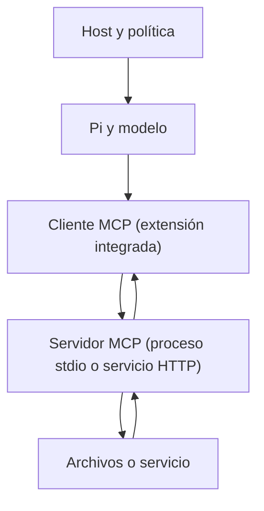

# 09 — MCP, composición y límites de confianza

Tiempo: 4 horas. Objetivo: conectar una capacidad externa de forma deliberada, limitar lo que expone y comparar su contrato con una extensión.

## Qué aporta MCP

Model Context Protocol estandariza cómo un cliente descubre e invoca capacidades de un servidor. Un servidor puede ofrecer herramientas y recursos; el modelo no necesita conocer su implementación. MCP no garantiza que los datos sean correctos ni que una operación esté autorizada. El host sigue gestionando acceso, selección, errores y evidencia.

Pi 0.99 incorpora MCP como extensión integrada: servidores stdio y HTTP *streamable* (el transporte SSE antiguo se rechaza). Comprueba siempre la interfaz de tu versión con `pi mcp --help`.

## Fronteras



Cada salto tiene contrato y permisos. El servidor stdio es un proceso con los permisos de tu usuario; un servidor remoto añade autenticación y red. Un resultado puede contener instrucciones hostiles igual que un archivo leído directamente.

## Configuración verificada en 0.99.1

| Operación | Comando o clave |
| --- | --- |
| Añadir servidor stdio | `pi mcp add <nombre> [-l] [--exposure <modo>] -- <comando> [args…]` |
| Añadir servidor HTTP | `pi mcp add <nombre> --url <url> [--bearer-token-env-var NOMBRE]` |
| Comprobar conexión y herramientas | `pi mcp list` (sale con código 1 si algo falla; `--json` para máquinas) |
| Gestionar en sesión | `/mcp` (estado, herramientas, exposición, activar/desactivar) |
| Archivo global / de proyecto | `~/.pi/agent/mcp.json` / `.pi/mcp.json` (con `-l`) |

Reglas fáciles de olvidar:

- `.pi/mcp.json` **solo se lee si el proyecto es de confianza**, porque un servidor stdio ejecuta comandos. `pi mcp add -l` avisa de que el archivo se ignora hasta que inicies Pi en el proyecto y lo aceptes.
- `command` es un ejecutable y `args` su lista de argumentos, no una cadena de shell.
- Los secretos se referencian con `${NOMBRE}` (variable de entorno) o `!comando`; nunca se escriben en el archivo que versionas.
- Las herramientas se llaman `mcp__<servidor>__<herramienta>`.

## Exposición: qué ve el modelo

Por defecto (`exposure: "codemode"`) las herramientas MCP **no se declaran al modelo**: se llaman desde scripts de la herramienta `codemode`, que Pi activa al conectar el servidor. Otros modos: `direct` (se declaran como herramientas normales), `deferred` (se descubren con `tool_search`), `codemode-deferred` y `hidden` (registradas pero inalcanzables). `toolExposure` fija el modo por herramienta y admite patrones con `*`.

Esto es un **control del harness**: con `exposure: "hidden"` y `toolExposure` solo para lecturas, las herramientas de escritura del servidor quedan inalcanzables para el modelo, aunque el proceso del servidor siga pudiendo escribir. Verificado con `@modelcontextprotocol/server-filesystem` 2026.8.31: anuncia 14 herramientas, entre ellas `write_file`, `edit_file`, `move_file` y `create_directory`; con la configuración siguiente `pi mcp list` marca como `direct` solo tres.

```json
{
  "mcpServers": {
    "filesystem": {
      "command": "npx",
      "args": ["-y", "@modelcontextprotocol/server-filesystem@VERSION_VERIFICADA", "E:\\Oscar\\PR260101\\Harness-MCP-Practica\\datos"],
      "exposure": "hidden",
      "toolExposure": { "read_text_file": "direct", "list_directory": "direct", "list_allowed_directories": "direct" }
    }
  }
}
```

La lista del servidor puede cambiar entre versiones: fija la versión, ejecuta `pi mcp list` y ajusta `toolExposure` a lo que anuncie.

## Laboratorio opcional de filesystem

El laboratorio 09 utiliza un directorio aislado con archivos sintéticos y el servidor filesystem de referencia. Necesita descargar una dependencia adicional; registra la versión real. No le apuntes a toda tu unidad E:. El directorio permitido limita qué rutas acepta el servidor; la exposición limita qué herramientas ve el modelo; ninguno de los dos es un sandbox del proceso.

## Composición de herramientas

`codemode` permite componer llamadas mediante JavaScript que se ejecuta en un sandbox **QuickJS** que solo alcanza las otras herramientas (`tools.<nombre>(args)`); solo la salida del script llega al modelo. Admite un límite de salida y un `timeout_ms` duro opcional. El sandbox limita el código de composición, pero los efectos de las herramientas invocadas siguen dependiendo de sus permisos. No equivale a aislar Pi completo.

Dos lecturas independientes pueden ejecutarse en paralelo si sus implementaciones lo permiten. «Leer saldo» seguido de «transferir importe calculado» tiene dependencia; no debe paralelizarse indiscriminadamente. Tampoco varios cambios sobre el mismo archivo sin coordinación.

## Subagentes como extensión futura

Un subagente puede aislar contexto y repartir una tarea, pero exige agregación, presupuesto global, límites de profundidad y estados de error. El curso no lo necesita para cuatro documentos. Si lo añades después, cada agente debe tener objetivo, capacidades y resultados definidos. No transfieras todas las credenciales por comodidad. Pi incluye un ejemplo de extensión `subagent` entre sus ejemplos empaquetados; léelo como diseño, no como capacidad integrada.

## Decisión práctica

Usa una extensión cuando la lógica está estrechamente unida a Pi y quieres interceptar eventos. Usa MCP cuando una capacidad debe compartirse entre distintos clientes. Usa SDK/RPC para integrar Pi en una aplicación. Pueden coexistir: una extensión puede incluso registrar un servidor MCP con `pi.registerMcpServer`. Elegir una interfaz no elimina las demás responsabilidades.

Ejercicio: redacta un ADR para exponer una búsqueda documental por extensión o por MCP. Evalúa reutilización, despliegue, permisos, pruebas y observabilidad. Ejemplo de referencia, para después: [ADR resuelto](../soluciones/lab09-adr-ejemplo.md).

## Errores frecuentes

- Esperar que el modelo «vea» las herramientas MCP con la exposición por defecto: están detrás de `codemode`.
- Crear `.pi/mcp.json` con `-l` y no conceder confianza: el servidor no se carga y no hay error en modo JSON.
- Confundir el directorio permitido del servidor con un sandbox del proceso.
- Copiar una configuración de otro cliente con `"type": "sse"`: Pi la rechaza.

## Autoevaluación

1. ¿Qué modo de exposición usarías para que el modelo solo pueda leer, y dónde se aplica ese control?
2. ¿Por qué Pi no lee `.pi/mcp.json` de un proyecto no confiable?
3. ¿Cómo se llamaría la herramienta `read_text_file` de un servidor llamado `filesystem`?
4. ¿Qué limita el sandbox de `codemode` y qué no?
5. ¿Cuándo preferirías MCP a una extensión?

Respuestas: [clave](../soluciones/autoevaluacion.md#09).

Práctica: [laboratorio 09](../laboratorios/09-mcp.md). Fuentes: [Pi MCP](https://pi.dev/docs/latest/mcp), [CLI: comandos MCP y codemode](https://pi.dev/docs/latest/cli), [introducción MCP](https://modelcontextprotocol.io/docs/2026-07-28/getting-started/intro).
