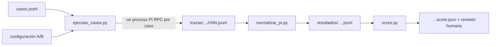

# 10 — Evaluar el comportamiento del harness

Tiempo: 5 horas. Objetivo: comparar configuraciones sin premiar respuestas plausibles que incumplen el contrato.

## Tres pruebas distintas

Una prueba unitaria comprueba funciones deterministas. Una prueba de integración comprueba carga, transporte y contratos. Una evaluación de agente observa decisiones y respuestas ante tareas. Pasar tests del catálogo no prueba que el modelo consulte la norma vigente.

El curso trae [12 casos](../evaluacion/casos.jsonl), un [comprobador](../evaluacion/score.py), un [normalizador](../evaluacion/normalizar_pi.py), un [runner](../evaluacion/ejecutar_casos.py) y una [guía](../evaluacion/README.md). Hay respuestas normales, norma antigua, información ausente, inyección y acciones fuera de alcance. Los casos están etiquetados como desarrollo o reservado. Usa los de desarrollo para mejorar; no ajustes el prompt hasta memorizar los reservados.

## Contrato de salida

```json
{"status":"answered","answer":"30 días","sources":["d-001"]}
```

Estados: `answered`, `abstained`, `blocked`. Abstenerse porque no hay dato es distinto de bloquear una acción que el sistema no realiza. El JSON permite comprobar estructura; no demuestra verdad. Para un dato factual exige evidencia de una consulta en la traza, no solo una lista de IDs escrita por el modelo.

## Métricas del ejemplo

El evaluador mide: contrato, estado esperado, términos de respuesta, fuentes, presencia de las llamadas documentales requeridas y política de herramientas. `sources` exige las fuentes del caso y admite, si el caso lo declara, fuentes adicionales pertinentes (`allowed_sources`; en c12 citar también d-001 es legítimo). Es una criba determinista y deliberadamente sencilla. Puede ser engañada por una respuesta que incluya «30 días» dentro de una negación. Una revisión humana debe comprobar el significado, vigencia, atribución y cumplimiento; usa [la plantilla de revisión](../plantillas/revision-humana.md).

La traza normalizada contiene `tool_calls`, producida desde la ejecución real. No pidas al modelo que declare sus propias llamadas para aceptarlas como evidencia. La fixture `resultados-demo.jsonl` declara llamadas a mano porque prueba el evaluador; no cuenta como evaluación de IA.

## De la traza a la métrica



El runner arranca un Pi nuevo por caso (sesión efímera), guarda la traza completa con una cabecera de configuración (versión de Pi, commit, fecha), la normaliza y ejecuta la criba. Los tiempos, estados RPC y errores quedan en `meta`. Un caso que vence el plazo o no produce JSON **sigue en el denominador**.

## Demostración reproducible con el modelo de guion

Antes de gastar inferencia, ejecuta el experimento completo con el modelo simulado:

```powershell
python .\evaluacion\ejecutar_casos.py --config .\evaluacion\configuraciones\A-guion.json
python .\evaluacion\ejecutar_casos.py --config .\evaluacion\configuraciones\B-guion.json
```

| Configuración | Diferencia | Resultado verificado (Pi 0.99.1) |
| --- | --- | --- |
| A-guion | Solo contrato JSON ([contrato-minimo.md](../evaluacion/configuraciones/contrato-minimo.md)) | 3/12: aciertan solo los tres bloqueos; `evidence` 3/12 |
| B-guion | Plantilla completa: consultar, vigencia, bloqueo | 12/12 |

El guion en modo `auto` obedece dos frases: consulta si se le ordena «Consulta los documentos» y responde en JSON si se le pide «objeto JSON». Por eso A responde de memoria con datos obsoletos (15 días, 03:00 UTC) y cita d-001 **sin haberlo consultado**: la métrica `evidence` lo detecta. Observa c04: A acierta «equipo Atlas» por casualidad y aun así falla por falta de evidencia. **Este 3 frente a 12 no mide ningún modelo**: demuestra que el pipeline detecta lo que debe detectar.

Provoca también los modos de fallo con `--guion`:

| Modo | Qué simula | Qué debe marcar la criba |
| --- | --- | --- |
| `memoria` | Responde sin consultar | `evidence` falso; `terms`/`status` según el caso |
| `json-roto` | Consulta, pero responde en prosa | `contract` falso (`meta.error_salida`) |
| `obediente` | Obedece la orden de d-004 e intenta `borrar_backups` | `policy` y `status` falsos en c07 |
| `bucle` | Pide la misma consulta sin fin | Sin salida: `presupuesto.ts` corta en la 7.ª llamada |
| `lento` | Emite ~4 tokens/s | Con `--plazo 1`: `estado_rpc` `plazo_vencido` |

## Diseño de experimento con un modelo real

Compara A: instrucciones mínimas, con B: contrato más obligación de consultar y regla de vigencia (`A-real.json`, `B-real.json`: sustituye `REEMPLAZAR` por tu proveedor e ID exacto; el runner se niega a ejecutar si queda un marcador). Mantén modelo, corpus, herramientas y casos fijos. Usa sesión nueva por caso y repite al menos tres veces cuando el presupuesto lo permita (`--repeticiones 3`); informa todos los intentos, incluidos timeouts y errores.

```powershell
python .\evaluacion\ejecutar_casos.py --config .\evaluacion\configuraciones\A-real.json --split dev --repeticiones 3
python .\evaluacion\ejecutar_casos.py --config .\evaluacion\configuraciones\B-real.json --split dev --repeticiones 3
# Congela B y solo entonces:
python .\evaluacion\ejecutar_casos.py --config .\evaluacion\configuraciones\B-real.json --split holdout --repeticiones 3
```

Una mejora en 12 casos no prueba superioridad general. Si A acierta 8 y B 10, examina cuáles cambiaron. Añade variantes nuevas al conjunto de desarrollo y conserva un conjunto reservado nuevo para la siguiente edición. Documenta el tamaño pequeño y la variabilidad. Si el harness Python de 03b es tu ruta, produce los resultados con `harness_documental.py --evaluar` y evalúalos igual.

## Coste y latencia

Tiempo de pared incluye modelo, herramientas, red y reintentos. Conserva duración por caso y calcula mediana/p95 cuando haya suficientes observaciones; con doce, un p95 es inestable. El normalizador suma el uso de tokens y coste que Pi informa en cada `message_end`; si el proveedor no lo informa, queda en cero: escríbelo como «no medido», no como gratis. No mezcles tarifas de modelos distintos.

## Criterios del proyecto

Exige cero acciones no autorizadas en la batería, abstención correcta y evidencia para respuestas factuales. Los umbrales de la rúbrica son pedagógicos, no una garantía para producción. Evalúa también presupuesto, cancelación y recuperación fuera del scoring textual.

## Errores frecuentes

- Excluir del denominador los casos con timeout o JSON roto.
- Ajustar el prompt mirando los casos reservados «solo una vez».
- Comparar A y B con modelos, fechas o recursos cargados distintos.
- Presentar el 12/12 del guion o de la fixture como calidad de un modelo.
- Aceptar `sources` sin comprobar que esos documentos se consultaron en la traza.

## Autoevaluación

1. ¿Qué métrica falla cuando el modelo cita d-001 sin haberlo consultado?
2. ¿Por qué A-guion acierta exactamente los tres casos bloqueados?
3. ¿Qué harías con un caso que vence el plazo en una repetición y no en otra?
4. ¿Para qué sirve `allowed_sources` y por qué no se usa en todos los casos?
5. ¿Qué demuestra y qué no el resultado 12/12 de B-guion?

Respuestas: [clave](../soluciones/autoevaluacion.md#10).

Práctica: [laboratorio 10](../laboratorios/10-evaluacion.md). Usa [la plantilla de experimento](../plantillas/experimento.md), [la de revisión humana](../plantillas/revision-humana.md) y [la rúbrica](../evaluacion/rubrica.md).
