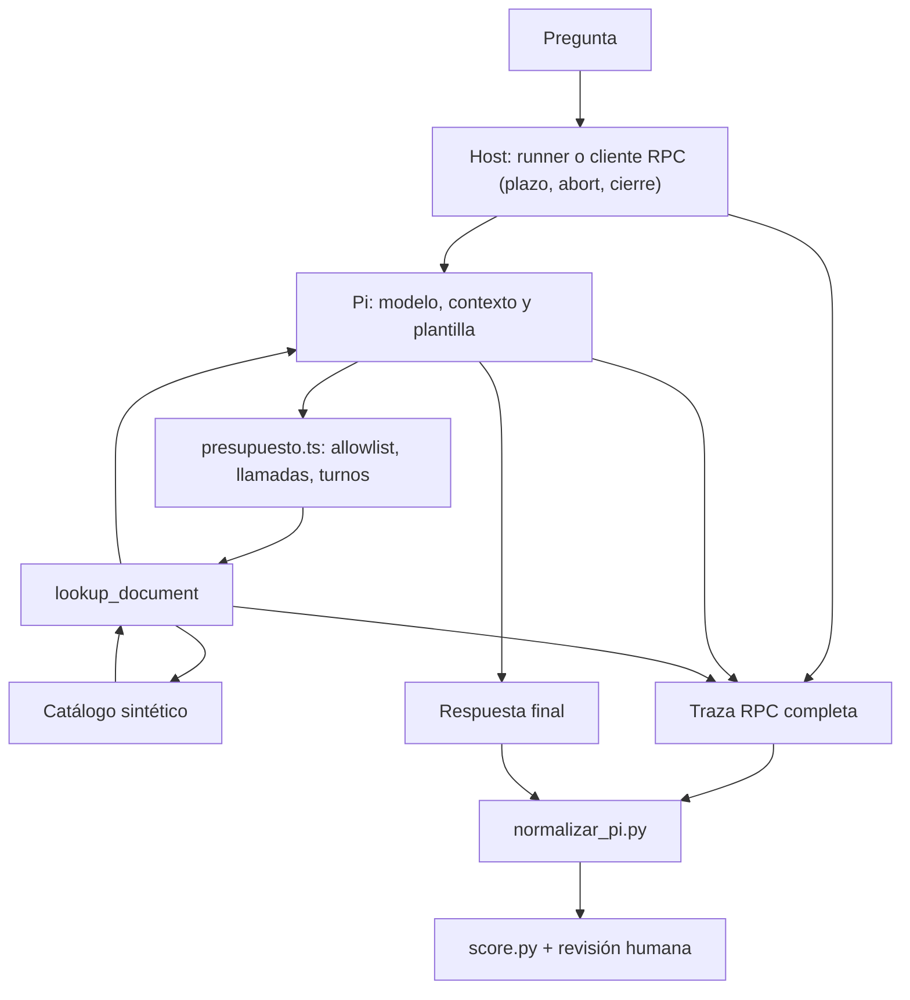

# Arquitectura inicial propuesta

La extensión aporta la herramienta; la plantilla aporta instrucciones; `presupuesto.ts` aplica límites que Pi no impone por defecto. El host controla ejecución y plazo, conserva la traza y la normaliza; la evidencia sale de los eventos, no del texto del modelo. En la base interactiva, parte del host es tu proceso manual de supervisión; el runner lo automatiza para la evaluación.

Decisión inicial: datos sintéticos en memoria, consulta por ID y cero herramientas de escritura. Beneficio: contrato pequeño y pruebas sin infraestructura. Límite: no escala a documentos que el modelo no pueda seleccionar por IDs conocidos. Al ampliar, añade búsqueda con referencias y límites (véase la solución de `search_documents`) antes de pensar en memoria compleja.

Alternativa: servidor MCP compartido. Beneficio: reutilización entre clientes. Coste: transporte, despliegue, otro proceso con permisos y exposición `codemode` por defecto. Registra tu elección con un ADR ([ejemplo](../soluciones/lab09-adr-ejemplo.md)).

Antes de gastar inferencia, la arquitectura completa debe pasar con el modelo de guion: A 3/12 y B 12/12. Si no, el fallo está en el harness.
