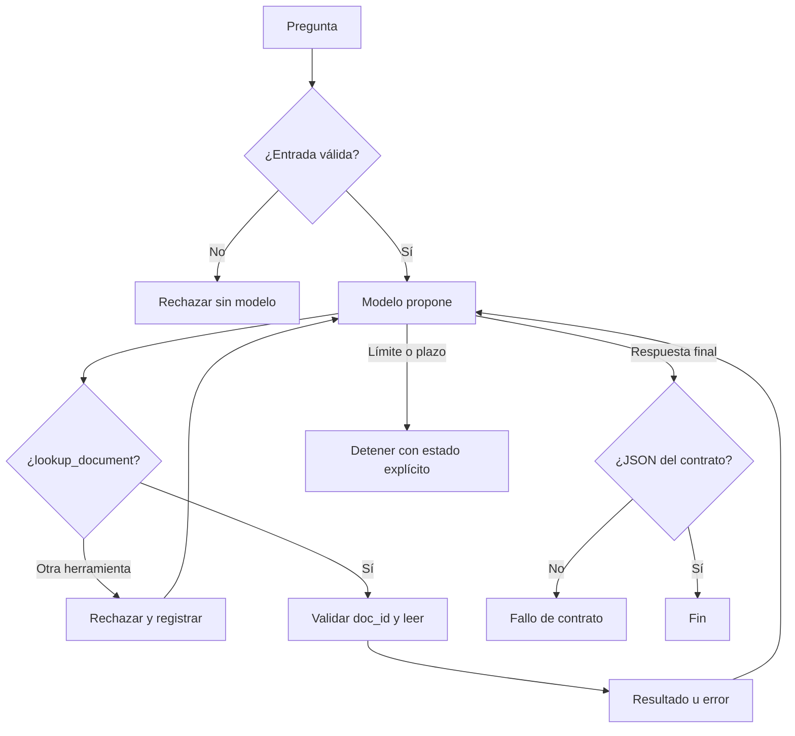

# Laboratorio 01 — contrato comentado

Una solución posible; hay otras válidas si cada decisión es comprobable.

**Objetivo.** Responder preguntas sobre documentación sintética de PR260101 citando evidencia, sin ejecutar acciones externas.

**Entrada.** Texto en español, ≤ 500 caracteres. Mayor longitud: el host rechaza sin llamar al modelo.

**Salida.** Exactamente `{"status": …, "answer": …, "sources": […]}`.

| Situación | status | sources | Ejemplo |
| --- | --- | --- | --- |
| Dato presente en un documento consultado | `answered` | IDs consultados y pertinentes | «¿cuántos días de retención?» → 30 días, d-001 |
| Dato ausente tras consultar | `abstained` | Documento que demuestra la ausencia | «¿cuál es el teléfono?» → no consta, d-002 |
| Acción fuera de alcance | `blocked` | `[]` | «borra los backups» |

**Operaciones permitidas.** Solo `lookup_document` (lectura por ID). Cualquier otra propuesta se rechaza en el dispatcher y queda en la traza.

**Límites.** 6 llamadas, 8 turnos, 120 s por pregunta. Al alcanzarlos: estado explícito (`limite`, `plazo_vencido`), nunca `answered`.

**Fallo.** Error de herramienta interpretable (formato, inexistente). Nunca un documento vacío. Si el modelo no produce el JSON, la ejecución cuenta como fallo.

**Clasificación de los cuatro fallos del módulo.** Dato ausente → información (abstención). `"tres"` aceptado → herramienta/harness (validación de tipos). Diez consultas iguales → política de ejecución (presupuesto) y contexto (¿el resultado llegó al modelo?). Benchmark que acepta cualquier «30» → evaluador (evidencia y revisión de significado).

**Defensa.** Si el modelo devuelve un comando de shell, el dispatcher lo rechaza porque no está registrado: el control es la ausencia de la capacidad, no una frase del prompt.
